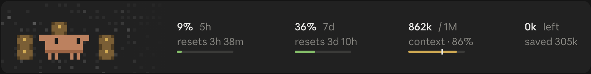

# pixel-buddy
Simple Claude Code plugin that shows usage meters, and a cache timer. That's really about it.

This is a fork of [hamymarnie/marnie-plugins](https://github.com/hamymarnie/marnie-plugins) with a redrawn band above the prompt.
The band shows exact figures for the 5h and 7d limits and the context, each with a thin bar, led by a pixel-art portrait of the mascot that runs into the band's edge. The portrait plays short looping scenes chosen by mood (working, done, relaxing, idle), and event scenes cut in: a compaction, and sub-agents at work.
With the [monster-compact](https://github.com/monsterlag/monster-compact) plugin (0.7.0 or later) the band also shows the tokens left before the next compaction and what the last one saved; without it those are left out.

```
/plugin marketplace add monsterlag/marnie-plugins
/plugin install pixel-buddy@monsterlag-plugins
```

All 22 scenes, frame by frame: [git-assets/scenes.png](./git-assets/scenes.png). The concept sheets the scenes were designed from are in [git-assets/concepts](./git-assets/concepts).
